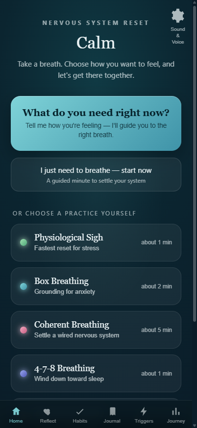
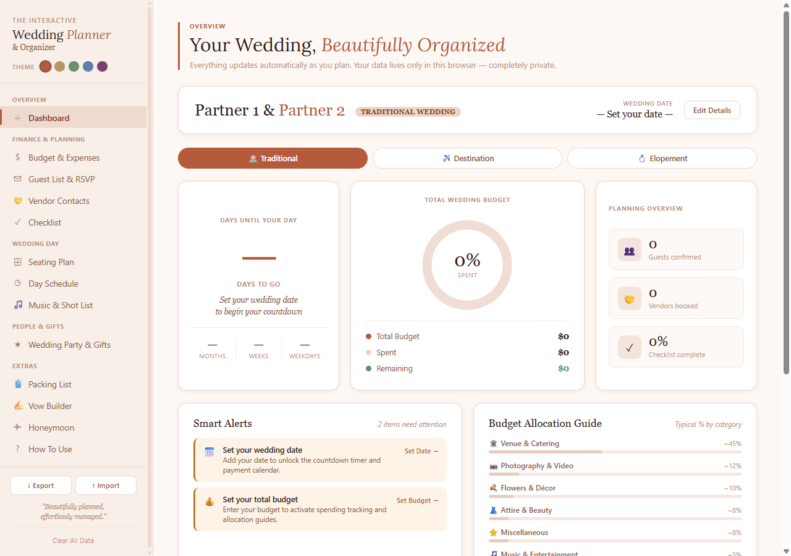
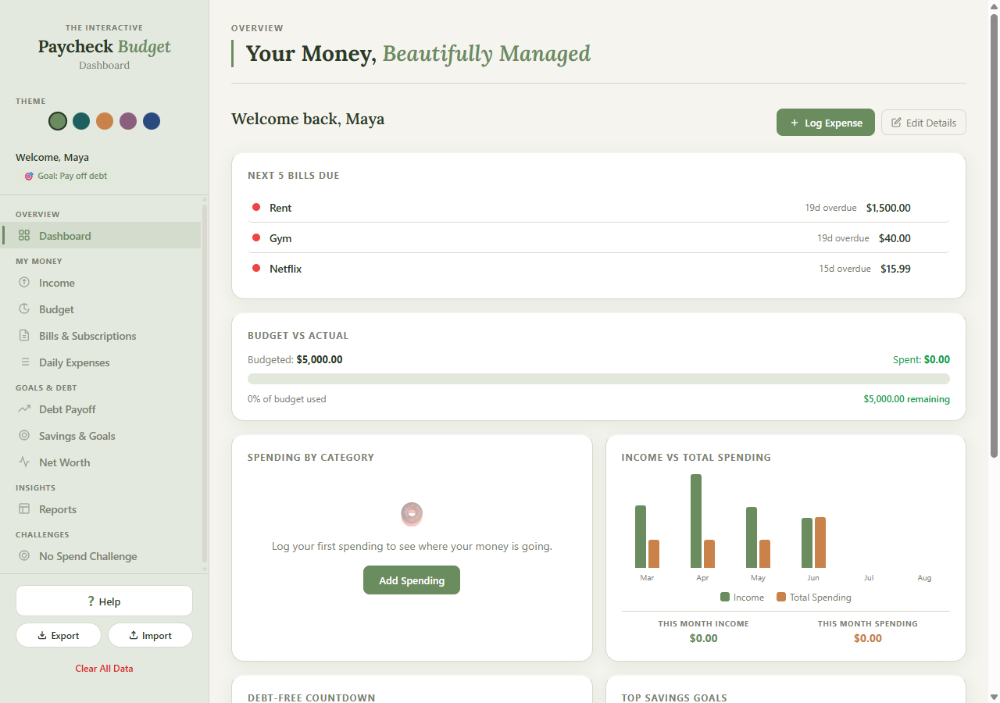
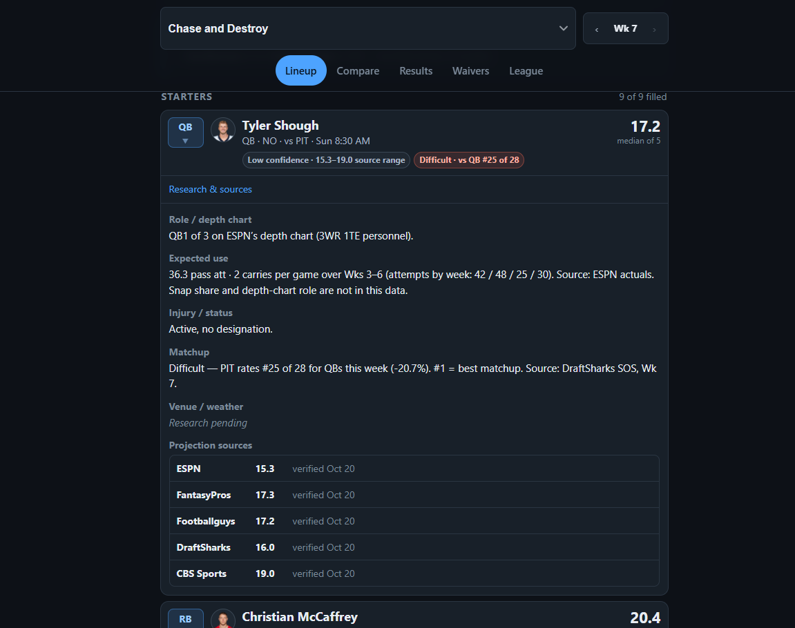
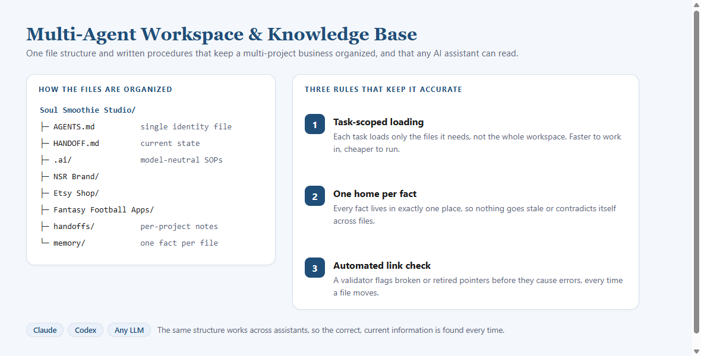

# Tahirih (Teri) Magee

**AI-Assisted Developer** | Web Apps · Documentation · Knowledge Systems

San Antonio, TX · terirunner11@gmail.com

I build real, working software with AI. This past year I used AI coding tools to design
and ship three browser-based web apps that run with nothing to install, plus a live-data
sports dashboard. I also built the file system and written procedures that keep an entire
multi-project business organized and easy to search.

This page is a showcase of that work: screenshots and plain-language write-ups. The source
code stays in private repos, since some of these are products I sell.

---

## Projects (2026)

### Nervous System Reset: Calm
*Breathwork and mood-tracking web app*

I built the whole app (guided breathing audio, private mood tracking, daily reset routines)
to run in any browser with nothing to install. Then I ran the full launch myself: the website,
an automated email welcome sequence, and the Instagram reels I produce.

**Tools:** HTML · CSS · JavaScript · Cloudflare · MailerLite
**Live:** https://soulsmoothiestudio.com

---

### Interactive Wedding Planner & Organizer
*Planning web app (sold online)*

A 14-section planner (budget, guest list and RSVP, vendors, checklist, seating chart, day-of
timeline, vow builder, honeymoon, and more) with automatic saving, one-click backup, and five
switchable color themes.

**Tools:** HTML · CSS · JavaScript · localStorage

---

### Interactive Paycheck Budget Dashboard
*Personal-finance web app (sold online)*

A full budgeting tool (income, spending, goals, debt, and insights). Every chart is drawn in
code instead of an outside library, so a user's financial data never leaves their device.

**Tools:** HTML · CSS · JavaScript · SVG

---

### Fantasy Football Dashboard
*Live-data web app*

A dashboard I built for my own three fantasy leagues that pulls current stats automatically each week instead
of hand-typed numbers, and merges several outside ranking and injury sources into one weekly
view. It turns that data into a clear start-or-sit read for every roster spot, weighing real
player usage, injuries, the week's matchup, and the betting lines. It is mobile-friendly and
redeploys itself each week, so the numbers are always current.

**Tools:** ESPN data · Node.js · Git · GitHub · Cloudflare

---

### Multi-Agent Workspace & Knowledge Base
*File system and SOPs*

I designed the file structure and written procedures so that the AI assistants I work with,
and I, find the correct, current information every time. Each task loads only the files it
needs instead of the whole workspace, every fact lives in one place so nothing goes out of
date, and an automated check flags broken links before they cause errors.

**Tools:** Markdown · Node.js · Git

---

## Technical Toolbox

- **Languages & Markup:** HTML, CSS, JavaScript, Markdown
- **AI & LLM Tools:** Claude / Claude Code, ChatGPT, Codex
- **Web & Deployment:** Git, GitHub, Cloudflare (Pages & Workers), PWA / localStorage, live data feeds
- **Productivity & Data:** Microsoft Office Suite, data entry (10-key, 50 WPM), MailerLite email

---

*Bachelor of Business Administration (BBA), Computer Information Systems. Texas A&M University System Center, San Antonio, TX.*
